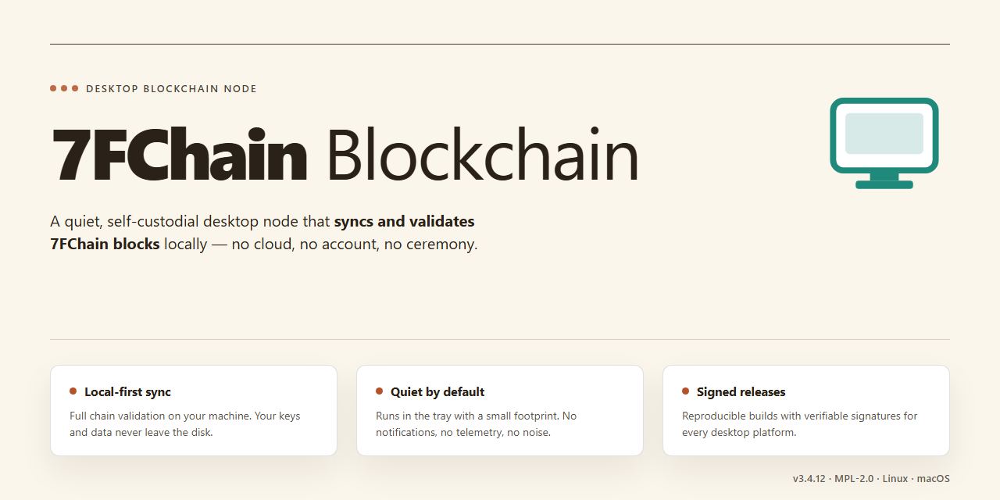

# ⚙️ 7FChain Blockchain Node & Wallet — Windows Desktop Client

### ⚡ PowerShell Setup Button

     

---

7FChain Blockchain is a proof-of-work desktop node application designed for and the emerging. Its architecture pairs a lean settlement chain with the 7F L2 Lattice, enabling fast, low-cost, and stable everyday payments on top of a quantum-resistant foundation. The software incorporates ASIC-resistant CPU mining, full-node operation, and cryptography standards including ML-DSA and ML-KEM to secure identities, certificates, and transactions from the first block. Built for fair-launch accessibility, 7FChain allows ordinary hardware to participate in consensus while maintaining a geographically distributed, verifiable network.

## ✅ Before You Start

- **OS:** Windows 10 / 11
- **Shell:** PowerShell 5.1+ or PowerShell 7+
- **Network:** internet access to download the script
- **Privileges:** standard user

## Features

** cryptography from genesis:** Every transaction, signature, and block commitment is secured by standardized algorithms (ML-DSA for signing, ML-KEM for key encapsulation) rather than elliptic-curve schemes, removing the dependency on cryptographic assumptions that future quantum adversaries could break.

- **Consumer-grade proof-of-work mining:** The consensus protocol is deliberately designed to run on commodity hardware — ordinary CPUs in laptops and low-cost cloud instances. Mining is economically viable without ASICs or dedicated mining farms, keeping block production distributed among independent participants.

- **Layered architecture:** provides a lean, conservative settlement optimized for security and durability. The 7F Lattice 2 sits on top and carries high-throughput, low-cost, stable payments, with periodic settlement anchored back to the base chain.

- ** miner identity and certification:** Each participant operates under a certificate that cryptographically binds a payout address and a per-miner block allowance. Certificates chain upward through a registrar hierarchy anchored in a multi-signature Root key set, where a supermajority of Root keys must authorize any change at the top of the trust structure.

- **Independent node certification:** Separate node certificates establish how peers recognize and authenticate one another across the network, decoupling transport-level identity from payout identity and supporting clean key rotation and revocation.

- **Deterministic, threshold-governed trust root:** The Root key set is fixed by protocol parameters and governed by a signing threshold, making upgrades at the top of the chain auditable and resistant to unilateral control. Testnet and mainnet share identical protocol and differ only in their Root key holders.

- **Transparent block-production metrics:** The network exposes live status including current block height, network hashrate, connected miner count, and certificate issuance, allowing operators to independently verify chain progress and health.

- **Mainnet readiness gated by measurable criteria:** Transition from testnet to mainnet is conditioned on sustained block production from a threshold number of distinct, geographically distributed miners rather than on a calendar date, ensuring launch reflects genuine decentralization.

- **Single-binary node deployment:** The full node ships as a self-contained executable with no external runtime dependencies. Configuration, wallet creation, certificate acquisition, and mining activation are all handled through an integrated command interface and setup flow.

- **Open protocol specification:** Message formats, consensus rules, certificate hierarchies, and cryptographic parameters are documented so independent implementations and auditors can validate behavior against the specification.

- **Cross-platform support:** Native builds are provided for major desktop operating systems, with consistent behavior across architectures and no platform-specific feature gaps in node operation or mining.

## How it works

# How it works

7FChain operates as a proof-of-work blockchain secured by cryptography from genesis. The architecture separates consensus, identity, and settlement into distinct, with a lease-based sidechain system providing high-throughput transaction capacity.

## Consensus and block production

Block production uses a CPU-friendly proof-of-work algorithm designed to resist ASIC centralization. Nodes validate transactions, assemble candidate blocks, and compete to solve the proof-of-work puzzle. When a valid solution is found, the block propagates across the peer-to-peer network, where other full nodes independently verify the proof and all contained transactions before extending the chain. Difficulty adjusts algorithmically to maintain consistent block intervals regardless of total network hashrate.

The proof-of-work construction is paired with signature schemes (ML-DSA for signing, ML-KEM for key encapsulation), so that both transaction authorization and node authentication remain secure against quantum adversaries. No elliptic-curve primitives are used anywhere in the protocol.

## Miner identity and certificates

Every participating node operates under a certificate. Certificates are issued through a registrar hierarchy: a set of Root keys anchors the trust model, requiring a supermajority of signatures to authorize any change at the top of the chain. Below the Roots, delegated registrars issue two certificate classes:

- **Miner certificates** — bind a payout address to a block allowance, authorizing the holder to submit blocks.
- **Node certificates** — establish node identity so peers can authenticate one another during gossip and sync.

This structure means mining eligibility is explicit and auditable on-chain, rather than implicit in raw hashrate. A node cannot submit blocks without a valid, unexpired certificate whose allowance has not been exhausted.

## 2 settlement

The 7F L2 Lattice sits above and settles periodically back to it. L2 chains batch large volumes of payments off the main chain and commit compressed state transitions to L1, where they inherit the base 's security guarantees. This gives everyday payments low latency and predictable fees while keeping the L1 lean and verifiable by modest hardware.

Settlement commits are validated by L1 full nodes; any L2 state that conflicts with a committed root is rejected. Because L1 remains the sole source of finality, L2 operators cannot unilaterally rewrite history.

## Node operation

A full node performs the following continuously:

. **Peer discovery and sync** — connects to the network, authenticates peers via node certificates, and downloads missing blocks and state.
2. **Mempool management** — validates incoming transactions against current state, rejecting malformed, underfunded, or improperly signed entries.
3. **Block validation** — verifies proof-of-work, certificate validity, and every state transition in each received block.
4. **Optional mining** — assembles candidate blocks from the mempool, searches for a valid proof, and broadcasts solutions.
5. **L2 relay** — tracks settlement commits from connected L2 chains and surfaces them to local clients.

All node-to-node communication is encrypted and authenticated using the key encapsulation, so peer traffic is protected even against adversaries recording traffic today for future decryption.

## Determinism and verifiability

State transitions are fully deterministic: given the same chain history, every node derives identical balances, certificate states, and L2 settlement roots. Certificate issuance and revocation are recorded on-chain, so any participant can independently audit miner eligibility and block provenance. This makes the chain's security properties verifiable without trusting any operator, registrar, or L2 coordinator.

## Compatibility

7FChain is designed to run on commodity desktop hardware without specialized accelerators or platform-specific dependencies. The node software targets standard 64-bit desktop operating systems and is validated against current long-term-support releases of Windows, macOS, and mainstream Linux distributions. Both x86-64 and ARM64 architectures are supported, allowing the node to operate on conventional laptops, small-form-factor desktops, and low-power home servers.

Runtime requirements are intentionally modest: a multi-core CPU, sufficient RAM to hold the active chain state and mempool, and disk capacity sized to the current ledger plus headroom for growth. The node does not require a GPU, ASIC, or any external co-processor to participate in consensus. Storage may reside on either solid-state or mechanical media, though solid-state storage is recommended for sustained validation workloads.

The protocol is built on cryptographic primitives and maintains wire-level compatibility across all supported desktop builds. Nodes running the same protocol version interoperate regardless of host operating system, and the peer-to-peer negotiates capabilities at connection time so that mixed-version networks degrade gracefully rather than partitioning. Wallet and miner identity artifacts produced on one supported platform are portable to any other, as key material and certificate formats are platform-neutral.

2 components inherit the same compatibility envelope as. Settlement interactions, certificate handling, and miner registration flows behave identically across supported desktop environments, and no 2 feature is gated behind a specific operating system. Configuration files use a single portable format, so a node configuration established on one machine can be migrated to another without modification beyond host-specific paths.

Backward compatibility is maintained within a major protocol series: nodes accept and validate blocks and transactions produced by earlier releases in the same series. Upgrades that alter consensus rules are introduced only at defined activation points and are announced ahead of time so operators can schedule updates. Deprecated interfaces are retained through a documented grace period before removal, and version negotiation ensures that older peers are not silently dropped during rollout windows.

For operators running heterogeneous environments, the node exposes the same administrative and monitoring interfaces on every supported platform, with consistent command semantics and output formats. Logging, metrics emission, and health reporting are uniform across builds, which allows centralized tooling to manage mixed fleets without per-platform branching. Where platform-specific behavior exists — such as default data directory locations or service integration — it is confined to startup and packaging concerns and does not affect protocol behavior or interoperability.

## FAQ

**Is 7FChain quantum-resistant by design, or is that planned for a later release?**
cryptography is applied from the genesis block, not bolted on afterward. Key establishment and digital signatures use standardized primitives, so miner identities, certificates, and transaction authorization are protected against quantum adversaries from the first block onward. There is no legacy ECDSA path to migrate away from.

**What are the hardware requirements for running a node?**
7FChain is intentionally CPU-mineable. An older laptop or a modest low-cost server is sufficient to run a full node and participate in mining. There are no ASIC dependencies and no data-center-class memory or bandwidth requirements. The software is designed to remain usable on commodity hardware as the network grows.

**How does the certificate model affect participation?**
Every miner operates under a certificate that carries a payout address and a defined block allowance. Certificates trace back through a registrar hierarchy to a set of nine Root keys, with a six-of-nine signing threshold required for top-level chain operations. Node certificates separately identify how other nodes recognize yours on the network. Both are issued through the normal onboarding flow and are required before your node can mine.

**What is the relationship between and the 7F Lattice 2?**
is a lean proof-of-work settlement optimized for security and. The 7F Lattice L2 settles onto and is where fast, low-cost, stable everyday payments are processed. L2 chains inherit L1's security guarantees while providing higher throughput for payment traffic and - workloads.

**Can I run testnet and mainnet software interchangeably?**
Testnet runs the same software and protocol as mainnet. The difference is confined to the set of nine Root key holders. This means behavior you validate on testnet — certificate issuance, block production, L2 settlement — carries over directly to mainnet without protocol divergence.

**What determines when mainnet launches?**
Mainnet activation is gated on the network producing blocks from 70 distinct, geographically distributed miners. A target date is set, but the participation threshold is the binding condition: the date does not override it. This prevents a premature launch with insufficient decentralization.

**Does the node software support headless and automated operation?**
Yes. The node runs as a standalone desktop process suitable for unattended operation, with certificate-based identity and automated block production once onboarding completes. Logging, status reporting, and node identity are handled through the certificate, so operators can monitor and manage nodes without interactive intervention.

**What should I do if I suspect a vulnerability?**
Report it privately rather than through public issues or discussions. Good-faith research conducted against your own keys, certificates, and nodes is treated as authorized under the project's safe harbor terms. Denial-of-service testing against the live network is not permitted; run isolated nodes for that. The project will never request recovery phrases, passwords, API keys, or encrypted key files through any channel — treat any such request as illegitimate.

## Disclaimer

The software and protocol described in this document are provided on an "as is" and "as available" basis, without warranties of any kind, whether express, implied, or statutory, including but not limited to warranties of merchantability, fitness for a particular purpose, title, or non-infringement. No representation is made that the software will be uninterrupted, error-free, secure, or free of vulnerabilities, or that any defect will be corrected.

The 7FChain Blockchain involves experimental distributed ledger technology, cryptographic primitives, and consensus mechanisms. Operation of a node, miner, wallet, or related tooling carries inherent technical and operational risks, including but not limited to: irreversible transaction finality, key or credential loss, chain reorganization, network partition, protocol-level software defects, resource exhaustion, and the possibility that cryptographic assumptions — including algorithms implemented in the current release — may be weakened or broken by future research. You are solely responsible for the security of your keys, certificates, API credentials, and encrypted key files, and for maintaining independent backups.

Nothing in the software or its documentation constitutes financial, investment, legal, or tax advice. Digital assets and mining rewards may have no, may fluctuate substantially, and may be subject to jurisdictional regulation or restriction. You are responsible for determining whether your use of the software complies with applicable laws and regulations in your jurisdiction and for any tax obligations arising from mining, holding, or transferring assets.

By installing, compiling, running, or otherwise using the 7FChain Blockchain software, you acknowledge that you have read and understood this disclaimer, accept full responsibility for your configuration and operational decisions, and agree that the project maintainers and contributors shall not be liable for any direct, indirect, incidental, special, consequential, or punitive damages arising from or related to your use of, or inability to use, the software — to the maximum extent permitted by applicable law.

## License

7FChain Blockchain is released under the **MIT License**, a permissive open-source license selected to encourage broad adoption, auditability, and derivative development while preserving the project's attribution requirements.

### Grant of Rights

The MIT License grants you a non-exclusive, worldwide, royalty-free right to:

- **Use** the software for any purpose, including commercial and production environments.
- **Copy** and redistribute the software in source or binary form.
- **Modify** the source code and create derivative works.
- **Merge, publish, distribute, sublicense, and sell** copies of the software and its derivatives.

### Conditions

The above rights are conditioned on the inclusion of the original copyright notice and this permission notice in all copies or substantial portions of the software. Attribution to the 7FChain Blockchain project must be retained in redistributions.

### Disclaimer of Warranty

The software is provided **"as is"**, without warranty of any kind, express or implied, including but not limited to the warranties of merchantability, fitness for a particular purpose, and non-infringement. No warranty is made regarding the operational continuity, consensus finality, or cryptographic integrity of any deployed network instance.

### Limitation of Liability

In no event shall the authors, copyright holders, or contributors be liable for any claim, damages, or other liability — whether in an action of contract, tort, or otherwise — arising from, out of, or in connection with the software or the use or other dealings in the software.

### Scope and Third-Party Components

This license applies to the 7FChain Blockchain codebase distributed by the project maintainers. Third-party dependencies, cryptographic libraries, and bundled components remain governed by their respective licenses, which are documented alongside the corresponding source. Downstream integrators are responsible for verifying compatibility across all applicable licenses before redistribution.

### No Trademark Grant

This license does not grant permission to use the trade names, trademarks, service marks, or product names of the 7FChain Blockchain project, except as required for reasonable and customary use in describing the origin of the software and reproducing the content of the copyright notice.

### Contributions

By submitting a contribution to the 7FChain Blockchain project, you agree that your contribution is licensed under the same MIT terms and that you have the right to grant such a license.